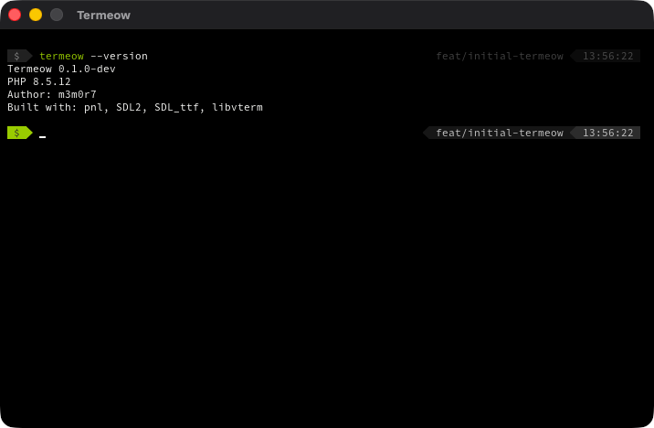
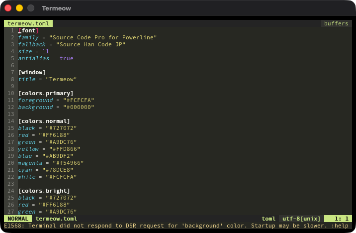

# Termeow

Termeow is a small terminal application written in PHP. SDL2 and SDL_ttf render the window, libvterm interprets terminal output, and a controlling pseudo terminal runs an interactive shell. Native libraries are accessed through [pnl](https://github.com/m3m0r7/pnl).

## Demo

### Termeow running



### Vim in Termeow



## Requirements

- PHP 8.3 or newer with FFI and mbstring
- Composer
- macOS or Linux with a desktop display
- libclang for pnl's binding generation
- `/usr/bin/script` and a monospace font
- Fontconfig (`fc-match`) when configuring fonts by family name

Pnl checks for SDL2, SDL2_ttf, and libvterm during `pnl install`. If they are missing, it offers to run the package's install recipe for the host OS. Separate Homebrew or apt commands are not needed on supported systems.

## Quick start

From this repository:

```sh
composer install
vendor/bin/pnl install \
  https://github.com/m3m0r7/pnl-packages/tree/main/packages/libsdl \
  https://github.com/m3m0r7/pnl-packages/tree/main/packages/libsdl-ttf \
  https://github.com/m3m0r7/pnl-packages/tree/main/packages/libvterm
bin/termeow
```

When installed as an application dependency, Composer creates `vendor/bin/termeow` in the consuming project:

```sh
composer require m3m0r7/termeow
(cd vendor/m3m0r7/termeow && ../../bin/pnl install \
  https://github.com/m3m0r7/pnl-packages/tree/main/packages/libsdl \
  https://github.com/m3m0r7/pnl-packages/tree/main/packages/libsdl-ttf \
  https://github.com/m3m0r7/pnl-packages/tree/main/packages/libvterm)
vendor/bin/termeow
```

Pnl generates platform-specific bindings in the installed Termeow package. The generated `pnlx-lock.json` is local and ignored; run the same three-target install command after replacing the package or changing the native platform. Composer does not run dependency scripts during installation. The command starts the shell in the caller's current directory.

Type `pwd` or `ls` and press Enter. `sl` works when it is installed on `PATH`. Ctrl+C interrupts the foreground job; Ctrl+K and the other supported control keys are passed to the shell. Close the window or type `exit` to quit.

Japanese input uses the system IME. Composition text appears underlined at the terminal cursor, with the native candidate window nearby. Only committed UTF-8 text is sent to the shell; keys used while composing do not submit a command.

`termeow -v` and `termeow --version` print the Termeow version, PHP runtime version, and credits. Inside the Termeow shell, entering `termeow` shows the same information. The child shell receives `TERM_PROGRAM=termeow` and `TERM_PROGRAM_VERSION`.

## Configuration

Configure fonts, colors, and the window title in `termeow.toml`. Termeow loads the package default, then `~/termeow.toml`, then `<cwd>/termeow.toml`; later files override only the keys they define. Relative font paths are resolved from the file that defines each font key:

```toml
[font]
family = "Source Code Pro for Powerline"
fallback = "Source Han Code JP"
size = 11
antialias = false

[window]
title = "Termeow"
```

The primary font must have equal-width ASCII glyphs. The fallback font supplies missing CJK and Powerline symbols. Use installed family names or absolute/configuration-relative font paths. The `[colors.primary]`, `[colors.normal]`, and `[colors.bright]` tables contain `#RRGGBB` values. ANSI colors 0–15 use the configured palette; indexed and true-color escapes are also rendered. The window uses the system title bar and an opaque background.

## Development

The code is split into terminal values (`src/Domain`), the terminal loop and ports (`src/Application`), and adapters (`src/Infrastructure`). SDL input and rendering live together under `Infrastructure/Sdl`; libvterm, PTY, configuration, and pnl each own their adapter modules. `TermeowTerminalFactory` assembles them through interfaces, while `bin/termeow` selects concrete implementations. Symfony Console provides the command and Symfony Process resolves font families. See [architecture](docs/architecture.md) for dependency boundaries and configuration precedence.

```sh
composer test   # PHPUnit unit and integration tests
composer stan   # PHPStan level max
composer cs     # PHP_CodeSniffer, PSR-12
composer check  # all three checks
```

The PHPUnit integration suite uses SDL's dummy video driver to check rendered bitmap pixels, including Japanese composition. It also starts a real shell through `/usr/bin/script` to exercise `pwd`, `ls`, Japanese UTF-8 output, version commands, Ctrl+C, and Ctrl+K. If `sl` is available, the suite checks its animation output. Native bindings must be generated before running the suite.

## License

MIT. See [LICENSE](LICENSE).
